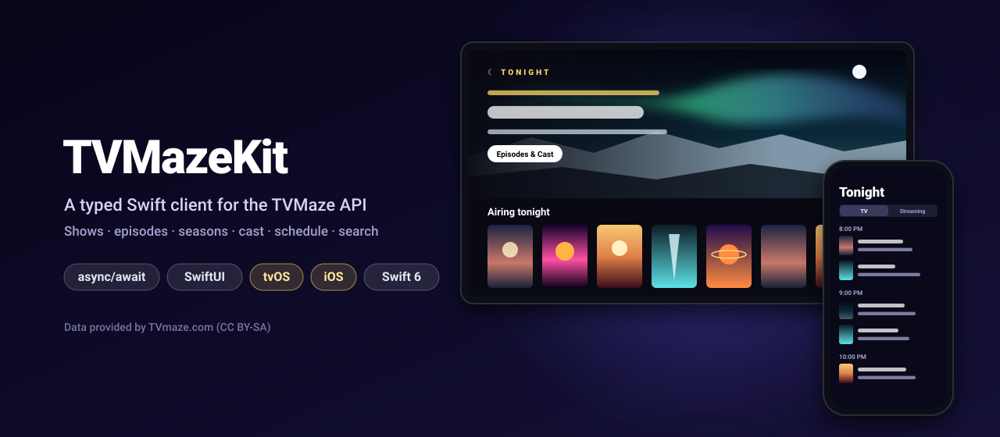
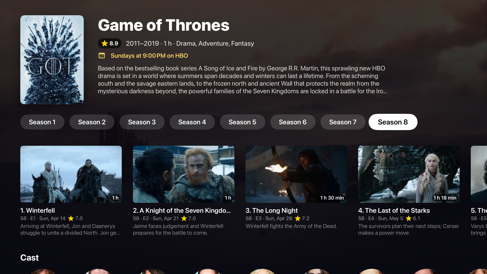
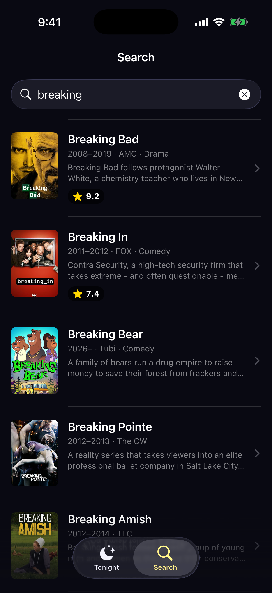
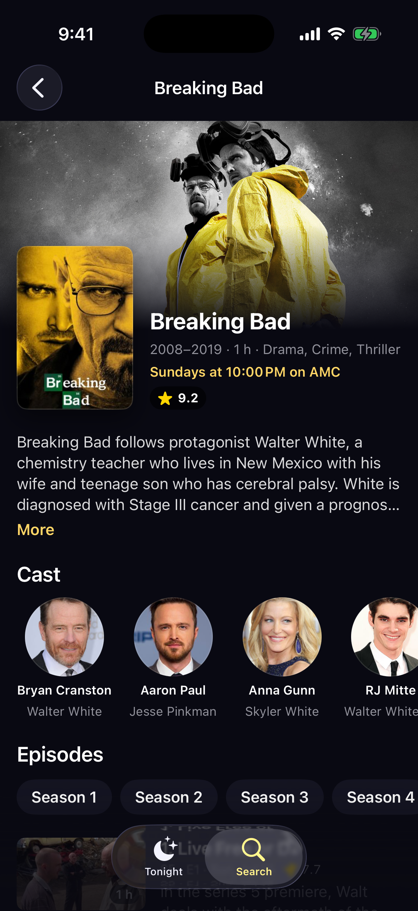
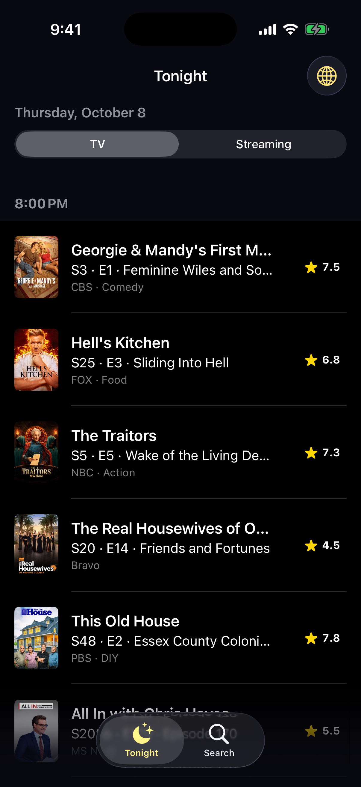

<p align="center">
  
</p>

<p align="center">
  <a href="https://github.com/halilozel1903/TVMazeKit/actions/workflows/ci.yml"></a>
  
  
  
  
  
  <a href="LICENSE"></a>
</p>

**TVMazeKit** is a Swift client for the free [TVMaze API](https://www.tvmaze.com/api), with SwiftUI views for a TV guide on **Apple TV and iPhone**. Search shows and people, look shows up by IMDb or TheTVDB id, load a show with its cast, seasons and episodes in one request, and get tonight's schedule on TV and streaming. Every endpoint is an `async throws` method returning typed models; the client stays inside TVMaze's rate limit on its own and retries when it is told to slow down. No API key, no dependencies.

```swift
import TVMazeKit

let tvmaze = TVMazeClient()

let show = try await tvmaze.show(id: 82, embedding: [.cast, .seasons, .nextEpisode])
print(show.name)                                     // "Game of Thrones"
print(show.rating?.average ?? 0)                     // Double?, out of 10
print(show.plainSummary ?? "")                       // summary without the HTML
print(show.cast.map(\.person.name))                  // the main cast

let tonight = try await tvmaze.schedule(country: "US")   // [Episode], each with its show
```

## Screenshots

Captured by CI from the example app, *Tonight*, on an Apple TV 4K and an iPhone simulator. The shows, networks and people in these scenes are made up: the screenshot scenes load recorded JSON fixtures in TVMaze's exact shapes, and the posters are artwork generated for the demo. A normal launch uses the live API.

| Home | Show |
| :---: | :---: |
|  |  |

| Search | Show | Schedule |
| :---: | :---: | :---: |
|  |  |  |

## Features

- **The whole public API**: search, single search, lookup by IMDb, TheTVDB or TVRage id, shows with embeds, episodes, episode by number and by date, seasons, season episodes, cast, crew, AKAs, images, the TV, streaming and full schedules, people and their credits, the show index and updates. See the table below.
- **Typed models that match the JSON**: `Show`, `Episode`, `Season`, `Person`, `CastCredit`… with `rating.average`, `schedule.days` as `Weekday`s, `network` and `webChannel`, `image.medium`/`.original`, `_links` and `_embedded` decoded into real properties. Dates the API gives without a time zone (`"2026-10-08"`) are `CalendarDate`s, `airstamp` is a `Date`.
- **Forgiving where the API is**: unknown statuses, show types and episode types still decode (`ShowStatus`, `ShowType`, `EpisodeType` are open string enums), empty `airdate`s and `officialSite`s become `nil`, specials have `number == nil`.
- **Plain-text summaries**: `plainSummary` strips TVMaze's HTML, keeps paragraphs and decodes entities (`&amp;`, `&#39;`, `&mdash;`…). It needs no `NSAttributedString`, so it runs on any thread.
- **Rate limiting built in**: a sliding-window `RateLimiter` keeps one client at TVMaze's 20 calls per 10 seconds, and HTTP 429 is retried after `Retry-After` or an exponential backoff (`RetryPolicy`).
- **Schedules made for a guide**: `scheduleSlots()` groups `/schedule` and `/schedule/web` results by start time and merges a season dropped at once into one entry.
- **Optional SwiftUI**: the `TVMazeUI` library has `ShowCard`, `EpisodeRow`, `CastStrip`, `ScheduleList`, `RatingBadge` and an image view with a swappable loader. Focus effects on Apple TV, compact layouts on iPhone. The client works without it.
- **Testable**: point the client at any `URLSession` and base URL; the package's own tests answer every request from a `URLProtocol` stub and recorded fixtures, never the network.
- **Swift 6 strict concurrency**: the client is `Sendable`, the limiter is an actor. Tested with Swift Testing on macOS and on iOS and tvOS simulators.

## API coverage

| Endpoint | Method |
| --- | --- |
| `GET /search/shows?q=` | `searchShows(_:)` → `[ShowSearchResult]` |
| `GET /singlesearch/shows?q=&embed=` | `singleSearchShow(_:embedding:)` → `Show?` |
| `GET /lookup/shows?imdb=` / `thetvdb=` / `tvrage=` | `lookupShow(.imdb("tt…"))` → `Show?` |
| `GET /search/people?q=` | `searchPeople(_:)` → `[PersonSearchResult]` |
| `GET /schedule?country=&date=` | `schedule(country:date:)` → `[Episode]` with `show` |
| `GET /schedule/web?date=&country=` | `webSchedule(date:country:)` → `[Episode]` with `show` |
| `GET /schedule/full` | `fullSchedule()` → `[Episode]` |
| `GET /shows/:id?embed[]=` | `show(id:embedding:)` → `Show` |
| `GET /shows/:id/episodes?specials=1` | `episodes(showID:includeSpecials:)` → `[Episode]` |
| `GET /shows/:id/episodebynumber?season=&number=` | `episode(showID:season:number:)` → `Episode?` |
| `GET /shows/:id/episodesbydate?date=` | `episodes(showID:airedOn:)` → `[Episode]` |
| `GET /shows/:id/seasons` | `seasons(showID:)` → `[Season]` |
| `GET /seasons/:id/episodes` | `seasonEpisodes(seasonID:)` → `[Episode]` |
| `GET /shows/:id/cast` | `cast(showID:)` → `[CastCredit]` |
| `GET /shows/:id/crew` | `crew(showID:)` → `[CrewCredit]` |
| `GET /shows/:id/akas` | `akas(showID:)` → `[AKA]` |
| `GET /shows/:id/images` | `images(showID:)` → `[ShowImage]` |
| `GET /shows?page=` | `shows(page:)` → `[Show]` (empty past the last page) |
| `GET /updates/shows?since=` | `showUpdates(since:)` → `[Int: Date]` |
| `GET /episodes/:id?embed=show` | `episode(id:embeddingShow:)` → `Episode` |
| `GET /episodes/:id/guestcast` | `guestCast(episodeID:)` → `[CastCredit]` |
| `GET /people/:id` | `person(id:)` → `Person` |
| `GET /people/:id/castcredits?embed=show` | `castCredits(personID:embeddingShows:)` → `[PersonCastCredit]` |
| `GET /people/:id/crewcredits?embed=show` | `crewCredits(personID:embeddingShows:)` → `[PersonCrewCredit]` |
| anything else | `get(_:query:as:)` decodes any path into your own `Decodable` |

Show embeds: `.episodes`, `.cast`, `.crew`, `.seasons`, `.images`, `.akas`, `.nextEpisode`, `.previousEpisode`.

## Installation

In Xcode choose **File › Add Package Dependencies…** and enter:

```
https://github.com/halilozel1903/TVMazeKit
```

Or add it to `Package.swift`:

```swift
dependencies: [
    .package(url: "https://github.com/halilozel1903/TVMazeKit", from: "1.0.0")
],
targets: [
    .target(name: "MyApp", dependencies: [
        .product(name: "TVMazeKit", package: "TVMazeKit"),
        .product(name: "TVMazeUI", package: "TVMazeKit"),   // optional SwiftUI views
    ])
]
```

## Usage

### Search and look up

```swift
let tvmaze = TVMazeClient.shared                     // one client, one rate limiter

let results = try await tvmaze.searchShows("severance")
for result in results {
    print(result.score, result.show.name, result.show.premiered?.year ?? 0)
}

let best = try await tvmaze.singleSearchShow("the office", embedding: [.episodes])   // nil when nothing matches
let byIMDb = try await tvmaze.lookupShow(.imdb("tt0944947"))
let byTVDB = try await tvmaze.lookupShow(.thetvdb(81189))      // Breaking Bad

let people = try await tvmaze.searchPeople("pedro pascal")
```

### A show page in one request

```swift
let show = try await tvmaze.show(id: 82, embedding: [.cast, .seasons, .episodes, .images, .nextEpisode])

show.genres                                   // ["Drama", "Adventure", "Fantasy"]
show.schedule?.days                           // [.sunday]
show.schedule?.airTime?.formatted()           // "9:00 PM", the network's local time
show.channel?.name                            // network, or web channel for streaming shows
show.externals?.imdb                          // "tt0944947"
show.backgroundImageURL                       // main background from the images embed
show.embedded?.nextEpisode?.airstamp          // Date?

for season in show.seasons {
    let episodes = show.episodes.inSeason(season.number)
    print(season.title, episodes.map(\.code))   // "Season 1" ["S01E01", "S01E02", …]
}
```

Without embeds, the same data has its own endpoints: `episodes(showID:includeSpecials:)`, `seasons(showID:)`, `seasonEpisodes(seasonID:)`, `cast(showID:)`, `crew(showID:)`, `akas(showID:)`, `images(showID:)` and `episode(showID:season:number:)`.

### Tonight's schedule

```swift
let today = CalendarDate.today(in: TimeZone(identifier: "America/New_York")!)

let tv = try await tvmaze.schedule(country: "US", date: today)
let streaming = try await tvmaze.webSchedule(date: today)           // every web channel

for slot in tv.scheduleSlots() {
    print(slot.time?.formatted() ?? "Any time")                     // "9:00 PM"
    for entry in slot.entries {                                     // most popular first
        print("  ", entry.show.name, entry.episode?.code ?? "")
    }
}
```

`/schedule` puts each episode's show in `show` and `/schedule/web` in `_embedded.show`; both end up in `Episode.show`. For streaming, a season released at once becomes one `ScheduleEntry` with all its episodes.

### People and credits

```swift
let person = try await tvmaze.person(id: 1)
let roles = try await tvmaze.castCredits(personID: 1)        // shows embedded
for role in roles {
    print(role.showName ?? "", "as", role.characterName ?? "", role.isVoice ? "(voice)" : "")
}
let jobs = try await tvmaze.crewCredits(personID: 1)
```

### Mirroring the database

```swift
var page = 0
while true {
    let shows = try await tvmaze.shows(page: page)   // 250 ids per page, [] past the end
    if shows.isEmpty { break }
    store(shows)
    page += 1
}

let changed = try await tvmaze.showUpdates(since: .day)  // [showID: last update]
```

### Errors, rate limits and retries

```swift
do {
    let show = try await tvmaze.show(id: 1)
} catch let error as TVMazeError {
    switch error {
    case .notFound: break                            // HTTP 404
    case .rateLimited(let retryAfter): break         // still 429 after every retry
    case .http(let status, _): break
    case .decoding(let type, let description): break
    case .transport(let urlError): break             // offline, timed out, cancelled
    case .invalidResponse: break
    }
}
```

Single lookups return `nil` instead of throwing when TVMaze answers 404 (`singleSearchShow`, `lookupShow`, `episode(showID:season:number:)`), and `shows(page:)` and `episodes(showID:airedOn:)` return an empty array.

TVMaze allows at least 20 calls every 10 seconds per IP address. Each client waits on a `RateLimiter` with that limit before every request (clients made with the same configuration do not share one; use `TVMazeClient.shared` or pass a limiter). Tune it, or turn it off behind your own cache:

```swift
let client = TVMazeClient(configuration: TVMazeConfiguration(
    rateLimit: .init(maxRequests: 10, per: 10),
    retryPolicy: RetryPolicy(maxRetries: 2, baseDelay: 1, maxDelay: 10),
    userAgent: "MyApp/1.0 (+https://example.com)"
))

let shared = RateLimiter(maxRequests: 20, per: 10)
let a = TVMazeClient(configuration: TVMazeConfiguration(), rateLimiter: shared)
let b = TVMazeClient(configuration: TVMazeConfiguration(), rateLimiter: shared)
```

### Testing your code

The client talks to whatever `URLSession` and base URL you give it, so tests can stub every response:

```swift
let configuration = URLSessionConfiguration.ephemeral
configuration.protocolClasses = [MyStubProtocol.self]

let client = TVMazeClient(configuration: TVMazeConfiguration(
    baseURL: URL(string: "https://stub.test")!,
    session: URLSession(configuration: configuration),
    rateLimit: nil
))
```

The models are `Codable`, so you can also decode recorded JSON directly: `try JSONDecoder().decode(Show.self, from: data)`.

### SwiftUI views

```swift
import TVMazeKit
import TVMazeUI

// A poster card. On Apple TV, the button style draws the focus effect.
NavigationLink(value: show.id) {
    ShowCard(show: show, caption: "9:00 PM · Northwind")
}
.buttonStyle(TVMazeCardButtonStyle())

// A search result row on iPhone.
ShowCard(show: result.show, style: .row)

// Episodes: beside the still in a list, below it on an Apple TV rail.
EpisodeRow(episode: episode)
EpisodeRow(episode: episode, style: .card)

// Round headshots with names and roles; focusable on Apple TV.
CastStrip(cast: show.cast) { credit in open(credit.person) }

// A day's schedule grouped by start time.
ScheduleList(episodes: tonight) { entry in path.append(entry.show.id) }

// The credit TVMaze's license asks for.
TVMazeAttributionView()
```

Images load through `TVMazeImage`, which uses the `TVMazeImageLoader` in the environment (by default `URLSession` with an in-memory cache). Swap it for your own cache, or for bundled artwork in previews:

```swift
ContentView()
    .tvMazeImageLoader(TVMazeImageLoader { url in
        try await MyImageCache.shared.data(for: url)
    })
```

## Example apps

The `Example` folder contains *Tonight*, a TV guide for Apple TV and iPhone built with TVMazeKit and TVMazeUI:

- **Apple TV**: the most popular show airing tonight as the hero, then focusable rails for *Airing tonight*, *Popular* and the biggest genres. A show page has its poster and facts, a season row whose selection follows focus, the season's episodes and the cast.
- **iPhone**: tonight's schedule (TV or streaming, by country), search as you type, and show pages with cast and episodes.

The project uses [XcodeGen](https://github.com/yonaskolb/XcodeGen) so no project file has to live in the repo:

```bash
brew install xcodegen
cd Example && xcodegen generate
open TVMazeKitDemo.xcodeproj
```

Run `TonightTV` on an Apple TV simulator and `TonightPhone` on an iPhone. Normal launches use the live API. Launch with `-screenshot home|show` (Apple TV) or `-screenshot search|show|schedule` (iPhone) to open a fixed scene from the recorded fixtures, as CI does for the screenshots above.

## Data attribution

**Data provided by [TVmaze.com](https://www.tvmaze.com).** TVMaze's data is licensed under [CC BY-SA 4.0](https://creativecommons.org/licenses/by-sa/4.0/): if you show it in your app, credit TVmaze.com with a link back, and share what you build on the data under the same license. `TVMazeAttribution.text` and `TVMazeAttributionView` give you the credit line. TVMazeKit is an unofficial client and is not affiliated with TVMaze.

The fixtures in this repository describe made-up shows, networks and people; their posters and photos are abstract artwork generated for the demo.

## Requirements

- Xcode 26 or later (Swift 6.2 toolchain)
- iOS 17+, tvOS 17+ (macOS 14+ for running the tests and using the client on the Mac)

## Contributing

Issues and pull requests are welcome. Please run the tests before opening a PR:

```bash
swift test
bash scripts/test.sh iOS
bash scripts/test.sh tvOS
```

## License

TVMazeKit is available under the MIT license. See [LICENSE](LICENSE). Data from the TVMaze API is licensed separately by TVMaze under CC BY-SA 4.0.
